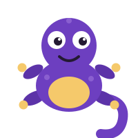

# Sang: informal mascot similarity review

Review date: 18 November 2026.

This is a small visual research exercise, not a trademark search, legal opinion, rights warranty or clearance. A shared animal, colour or tail shape does not by itself establish copying. Conversely, not finding a close reference in this search does not establish that the design is unique or safe to register.

## Design and provenance

Sang is a flat, side-on violet gecko with a large amber slit eye, a smaller far eye, head crests, orange toe pads, back spots and a dotted spiral tail.

The design was constructed directly with SVG paths and shapes, with visual revisions. No stock-art or generated-image asset was introduced in the recorded construction. That is a statement about the observed creation process, not evidence that no similar character exists. The Android frames are later transformations of this SVG: tail rotation and a blink overlay. The launcher icon is a head crop with a background and version badge.

The project's AGPL-3.0 license should not be read as a legal clearance of its mascot or as permission to copy another project's character.

## Method

The review used web searches and side-by-side inspection of accessible reference images. It covered some purple reptiles, curled-tail software mascots and community-made language-learning alternatives. Third-party artwork is linked, not redistributed here. A source page being accessible is not a grant to reuse its art.

The observations below distinguish inspected pictures from descriptions that were only read. They also distinguish proposed artwork from a confirmed current mascot.

## Open-source and community language-learning projects

| Project and source | What was inspected | Observation and limits |
| --- | --- | --- |
| [LibreLingo mascot discussion](https://github.com/kantord/LibreLingo/issues/90) | Turtle A/B proposals and a pose sheet | Flat-vector turtles with blue shells and orange skin. The animal and upright silhouette differ from Sang. This review does not establish which artwork, if any, is the project's current adopted mascot. |
| [LibreLingoRelive logo discussion](https://codeberg.org/LibreLingoRelive/LibreLingoRelive/issues/64) | Butterfly artwork in the fork's logo discussion | Yellow/black butterfly with lettering, not a reptile. The discussion documents a change of visual identity; it should not be treated as proof of deployment everywhere. |
| [LangQuest repository](https://github.com/LangQuest-App/LangQuest) | Front and side frog images in `public/images/` | Green cartoon frog with a red-brown outline. Different colour, species and stance from Sang. |
| [Lingonaut crew page](https://lingonaut.app/meet-the-crew) | Accessible astronaut/crew artwork | White/blue astronaut figures and a dark round-faced figure. These are crew images, not a verified view of Speck. Speck remains visually unchecked in this review. |
| [tama repository](https://github.com/tamnd/tama) | README description only | Described as a cat mascot. No visual comparison is claimed. |
| [Freelingo repository](https://github.com/Blueturboguy07/freelingo) | Text only | No usable mascot image was inspected. No visual conclusion is claimed. |

No close Sang match was identified in the inspected pictures in this limited group. That conclusion does not extend to the unviewed mascots, every Duolingo alternative, older revisions or unindexed projects.

## Other visual references

These comparisons broaden the search beyond open-source language apps. They are visual observations, not claims of influence, affiliation or endorsement.

| Reference | Shared traits | Visible differences |
| --- | --- | --- |
| [Randall Boggs](https://disney.fandom.com/wiki/Randall_Boggs), Monsters, Inc. | Purple lizard-like character, head projections and a broad grin | Scaled CG treatment, lavender colouring, heavy-lidded eyes and a different body/head structure. Sang has flat shapes, large amber eyes, orange pads and a dotted spiral tail. |
| [openSUSE Geeko reference](https://news.opensuse.org/2023/12/05/journey-of-os-rebrand/) | Side-on flat-vector reptile and curled tail | Green chameleon with a different head profile. The overlap is in broad silhouette/style, not Sang's full combination of details. |
| [Mozilla/Netscape historical reference](https://home.snafu.de/~tilman/mozilla/index.html) | Lizard mascot | The inspected image is green and upright with sunglasses. This is a historical reference, not a complete survey of Mozilla artwork. |
| [Gex](https://gex.fandom.com/wiki/Gex_(character)) | Gecko character | Green/yellow, upright presentation with sunglasses in the inspected reference. |
| [Spyro reference image](https://www.pngall.com/spyro-png/download/385972/) | Purple reptile | Three-dimensional dragon with gold horns, wings and belly plates, rather than a side-on gecko. |
| [Rango](https://apps.apple.com/us/app/rango-language-learning/id6791895003) | Language-learning reptile mascot | Mint-green chameleon head on a blue tile in the inspected app image. |
| [Gillo](https://www.getgillo.com/meet-gill) | Friendly language-app creature | Teal, horned, axolotl-like design in the inspected image. |
| [Kameleon](https://kameleonapp.com/) | Chameleon with spiral tail | Green/teal character on a branch. |
| [A purple gecko costume listing](https://www.masticot.com/en/mascots-geckos/91165-purple-cartoon-geckos-mascot.html) | Purple, friendly gecko concept | Upright costume with different proportions and eyes. One listing demonstrates that the broad concept exists elsewhere, not how common it is or whether it presents a legal conflict. |

## Interpretation

Purple reptiles, friendly grins, flat-vector lizards and curled tails already appear separately in other characters. The inspected references did not combine Sang's particular visible details closely enough for this review to identify a close design match. That is a limited visual judgment, not a legal finding or an explanation of any viewer's feeling of familiarity.

## What remains unchecked

- Reverse-image matching and a wider image search.
- Trademark databases, registered designs and jurisdiction-specific conflicts.
- Similar names, commercial categories and likelihood of consumer confusion.
- Unviewed mascot artwork, including Speck and the text-only entries above.
- Historical variants, less-indexed apps and regional projects, including a dedicated Indonesian search.

Before relying on the mascot for registration, licensing or substantial commercial distribution, obtain a scoped professional assessment covering the intended territories and uses. Registration, ownership documentation and clearance are different questions. This note makes no claim that professional clearance has been obtained.
